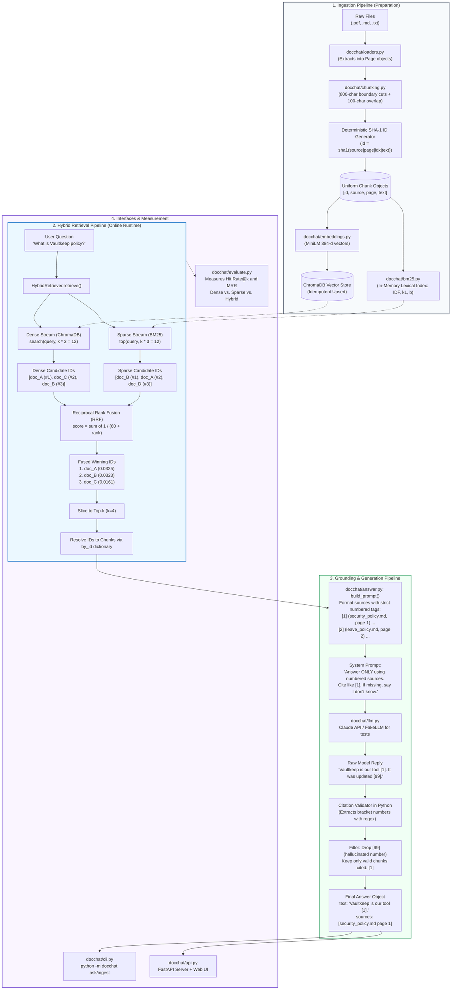

# DocChat RAG: Complete Architecture, Visual Flow & Interview Guide

This guide is a persistent reference for understanding, explaining, and interviewing on the DocChat hybrid RAG system (Commits 1 to 14).

---

## 1. End-to-End System Architecture

---

## 2. The 3 Levels of RAG (Industry Classification)

### Level 1: Naive RAG (Tutorial RAG)
* **Pipeline:** Fixed-size chunking $\to$ Bi-encoder $\to$ Vector DB $\to$ Cosine top-$k$ $\to$ Prompt $\to$ LLM.
* **Failure Modes:** Fails on exact keywords (error codes, product IDs), cuts sentences in half, suffers from hallucinations, no citation verification, impossible to measure retrieval separately from generation.

### Level 2: Advanced Hybrid RAG (Production Baseline — DocChat)
* **Pipeline:** Boundary-aware chunking with overlap $\to$ Parallel Dense (Chroma) & Sparse (BM25 from scratch) $\to$ Over-fetch $k \times 3$ $\to$ Reciprocal Rank Fusion (RRF) $\to$ Grounded citations `[1]` with Python validation $\to$ Retrieval benchmark eval (Hit Rate@k & MRR).
* **Reality:** Powers 90% of commercial enterprise search (Perplexity, Notion AI, GitHub Copilot Chat).

### Level 3: Modular & Agentic RAG (Phases 4 & 5)
* **Pipeline:** Dynamic routing, query rewriting (HyDE), tool invocation (SQL, Vector, Web, API), self-correction loops (Self-RAG / CRAG), and multi-hop relationship traversals (Knowledge Graphs).

---

## 3. Deep Dive: RRF vs. Cross-Encoder Reranker

| Feature | Reciprocal Rank Fusion (RRF) | Cross-Encoder Reranker |
| :--- | :--- | :--- |
| **What data does it inspect?** | **Only integer rank positions** (`#1, #2, #3`) | **The raw text tokens** of query + document |
| **Reads document text?** | ❌ No (Text-blind) | ✅ Yes (Full cross-attention) |
| **Added Latency** | **`~0 ms`** (instant math) | **`~120 ms`** (neural network inference) |
| **Infrastructure needed** | Plain Python math on CPU | Transformer model (`sentence-transformers` / API) |
| **Where it fits in pipeline** | Merges 2 raw lists into 1 list | Re-scores the top 50 candidates into top 4 |

### The Chef Analogy:
* **RRF:** A judge looks only at two ranked ballot cards: `#1 Chef Alice, #2 Chef Bob`. It calculates score sums without ever smelling the kitchen or tasting the dish.
* **Cross-Encoder Reranker:** The judge actually sits down, eats the dish together with the menu description, and scores its exact quality.

---

## 4. Top 12 RAG Technical Interview Questions & Model Answers

### Ingestion & Chunking
1. **How do you pick chunk size and overlap?**
   * *Answer:* Large chunks dilute vector meaning; small chunks lose context. We use boundary-aware cuts (~800 characters) with overlap (~100 chars) to prevent splitting sentences or words in half. We treat `chunk_size` as a hyperparameter tuned against a labelled evaluation set, not a guess.
2. **What happens if you run ingestion twice? How do you prevent duplicates?**
   * *Answer:* We ensure idempotency by generating deterministic SHA-1 hashes from `source | page | index | text` as chunk IDs. The vector database performs an idempotent `upsert`, updating existing chunks in place rather than bloating the store with duplicates.
3. **Why keep metadata (`source`, `page`) on every chunk?**
   * *Answer:* Provenance is required for user-facing citations, offline debugging of retrieval misses, and pre-filtering queries by user permissions or document categories.

### Embeddings & Vector Stores
4. **Why cosine similarity instead of Euclidean distance?**
   * *Answer:* Cosine similarity measures the angle between vectors, capturing semantic orientation regardless of document length. Euclidean distance measures straight-line distance, which gets skewed by vector magnitude unless normalized. Empty text needs a non-zero bucket guard to prevent division-by-zero errors.
5. **How does vector search scale to 10M+ documents?**
   * *Answer:* Brute-force comparison is $O(N)$. Production databases use Approximate Nearest Neighbor (ANN) indexes like HNSW (Hierarchical Navigable Small World) to search in $O(\log N)$ time. At massive scale, we add scalar quantization (`float32` $\to$ `int8`) and metadata pre-filtering.

### Hybrid Retrieval & Fusion
6. **Why does pure vector search fail in production?**
   * *Answer:* Embeddings excel at conceptual paraphrasing ("vacation" $\to$ "annual leave"), but treat unique alphanumeric codes (`ERR_401`, product IDs, abbreviations) as generic subword tokens. BM25 solves this with exact lexical token matching via Inverse Document Frequency ($IDF$), term-frequency saturation ($k_1$), and length normalization ($b$).
7. **What is RRF and why not add raw cosine and BM25 scores?**
   * *Answer:* Cosine similarity ($0.0 \dots 1.0$) and BM25 ($0.0 \dots 20+$) are on incompatible scales. Adding them allows BM25 to overpower the vector score. RRF uses scale-free rank positions: $\sum \frac{1}{60 + \text{rank}}$. It requires no manual weight tuning and naturally propels documents that rank high in both streams to the top.
8. **Why over-fetch with $k \times 3$ candidates?**
   * *Answer:* A document ranked #5 in vector search and #5 in BM25 would be missed if we only fetched $k=4$ from each side. By pulling 12 candidates from both, RRF captures it in both pools, combines its scores, and pushes it into the final top 4.
9. **What is a cross-encoder reranker and why add it after RRF?**
   * *Answer:* Vector search uses bi-encoders (encoding query and document independently for fast indexing). A cross-encoder encodes query and chunk together with full cross-attention. Reranking top 50 hybrid candidates provides a 33%–40% accuracy improvement for ~120ms added latency.

### Grounding, Debugging & Evals
10. **How do you prevent hallucinations and prompt injection?**
    * *Answer:* The system prompt treats documents as data (not instructions) and requires citations like `[1]`. If retrieval returns no chunks, code short-circuits directly with "I don't know". All citations are validated in Python using regex; hallucinated numbers are dropped before returning the answer.
11. **How do you debug a wrong answer from a RAG bot?**
    * *Answer:* Isolate the 3 stages: 1) Check raw chunks in the database (did parsing truncate the text?); 2) Check what `retrieve(query)` returned (was the right chunk in the top-$k$?); 3) If the right chunk was in the prompt, check prompt instructions and LLM context limits.
12. **Why evaluate retrieval separately from generation?**
    * *Answer:* Most bad answers are retrieval failures, not LLM failures. Retrieval evaluation uses Hit Rate@k and Mean Reciprocal Rank (MRR) on a labelled dataset with paraphrased questions. It runs in milliseconds with zero LLM API costs. Generation evaluation uses LLM-as-a-judge for faithfulness and answer relevance.
